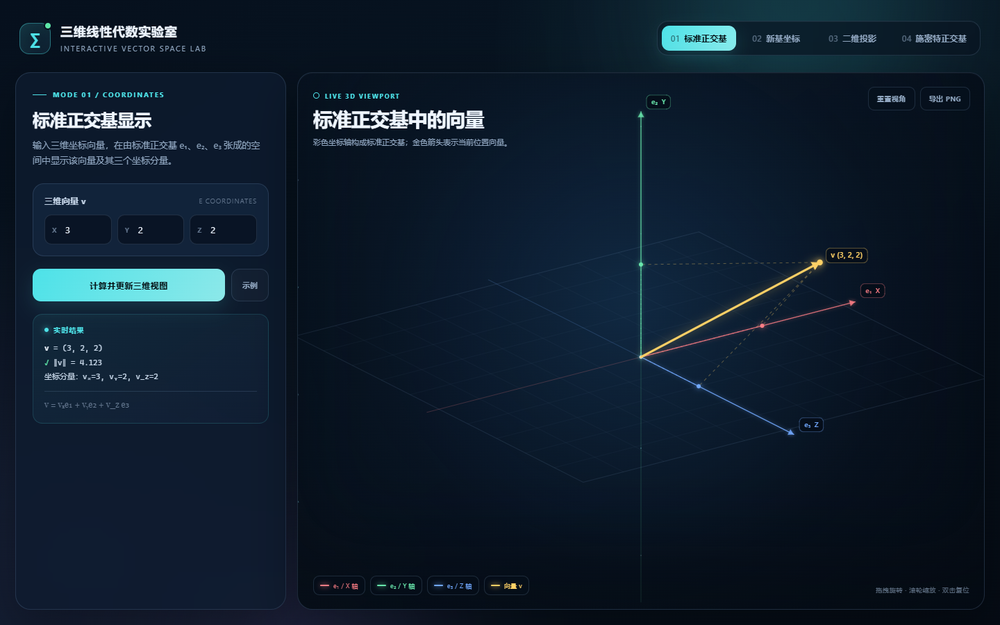

# 三维线性代数交互实验室

这是一个只包含一个 `index.html` 文件的 HTML5 线性代数可视化项目，可直接用现代浏览器打开，不需要安装依赖或启动服务器。

## 功能

1. **标准正交基显示**：输入三维坐标向量，在标准正交基 `e1, e2, e3` 中显示向量与坐标分量。
2. **新基坐标**：输入三个新的基向量，通过求解 `Bc = v` 计算向量 `v` 在新基 `B` 下的坐标。
3. **三维到二维投影**：给定一组三维向量和两个平面基向量，计算向量到二维平面的正交投影，并显示投影点的二维坐标。
4. **施密特正交基**：对一组三维向量执行改进的 Gram-Schmidt 正交化，显示两两正交的单位向量及其数值结果。

## 使用方法

直接双击 `index.html`，或在浏览器中打开该文件。

- 拖拽画布：旋转三维视角
- 鼠标滚轮：缩放视图
- 双击画布：重置视角
- “导出 PNG”：保存当前可视化画面

## 运行环境

支持 Canvas 2D 和 ES2020 的现代浏览器，例如 Chrome、Edge、Firefox 或 Safari。

## 数学约定

- 新基向量按列组成矩阵：`B = [b1 b2 b3]`。
- 新基坐标通过 `c = B^-1 v` 计算。
- 二维投影平面由 `a1, a2` 张成，先正交单位化得到 `q1, q2`，再利用 `P(v) = q1q1^T v + q2q2^T v` 计算投影。
- 施密特正交化采用两遍投影以减小浮点误差。
